# C2 数据库与关键图件设计说明

更新：2026-11-22。本文把数据库关系、关键类的职责和主要调用过程放在一起，便于队友阅读和现场讲解。对应当前RBAC1＋JWT实现，复用现有StarUML图源及导出图，不新增数据库结构或另一套设计。

建议顺序：先看数据库中的角色关系，再看继承维护、有效权限、申请审批，最后看可信身份与JWT。业务全貌见[项目总结](项目总结.md)，运行和实测分别见[部署说明](../部署/README.md)、[测试说明](../测试/README.md)。

## 1. 这些图分别回答什么问题

| 图的类型 | 重点看什么 | 不应混淆的内容 |
| --- | --- | --- |
| 陈氏ER图 | 实体、属性、联系、基数，描述业务概念 | 角色的业务继承不是Java类继承 |
| 逻辑ER图 | 表、主键、外键、组合键与约束，说明如何落库 | 外键完整性不能代替授权、无环和状态校验 |
| 类图 | 谁保存数据、谁计算规则、谁组织用例、谁访问存储 | 类之间的依赖不是调用时间顺序 |
| 时序图 | 一次请求经过哪些对象、先后顺序、事务和拒绝点 | 顺序图不代表所有异常和并发场景都已穷举 |
| 活动图、状态图 | 条件分支、工作流和允许的状态转换 | 前端流程和状态允许不等于已经具备业务权限 |

图片直接引用design/exports，不复制图片。点击图片或同主题SVG可放大；现有导出带StarUML试用水印，本文保留。完整49组图件和源码/测试关联见[图件索引](design/图件索引.md)，可编辑源文件为[C2-RBAC1.mdj](design/C2-RBAC1.mdj)。

## 2. 数据库设计

### 2.1 两版结构与存储分工

功能版与对象版使用独立MySQL库，表结构一致，业务数据分别写入。部署逻辑库为ooad_rbac1_func、ooad_rbac1_oo；本机已有演示服务使用带_review后缀的库，不能把示例库名当作当前实际连接。

MySQL保存账号、组织、授权和申请；Redis保存按版本隔离的sid登录状态、当前刷新凭证摘要及已消费摘要。JWT迁移移除了Spring Session，Redis服务仍然需要；JWT没有新增MySQL用户版本表或tokenVersion字段。

当前Flyway为V1—V9，共17张应用表，另有Flyway自己的历史表。两版差异主要在代码职责，不以表数量不同体现面向对象设计。

| 表 | 职责与关键关系 |
| --- | --- |
| organization | 公司/部门及parent_id；当前模型为公司和直属部门，不承诺任意深层组织策略 |
| employee | 员工、组织归属、enabled及原表来源信息；导入未匹配组织的记录可保留，但不能据此取得登录资格 |
| login_account | employee_id为主键和外键，保存密码哈希；员工可以没有本地登录账号 |
| administrator_scope | 每员工至多一条管理范围；全局或指定组织，不等于业务角色权限 |
| rbac_role | 角色；owner_organization_id为空表示共享角色，否则属于指定组织 |
| permission | 权限码及system_id；同码可属于不同业务系统，不能只按code跨系统授权 |
| business_system | 业务系统、所属组织及默认工作区标识 |
| employee_role | 员工—角色多对多，组合主键(employee_id,role_id) |
| role_permission | 角色—直接权限多对多，组合主键(role_id,permission_id) |
| role_inheritance | 角色自关联的直接继承边，组合主键(senior_role_id,junior_role_id) |
| role_hierarchy_lock | 固定一行的图写锁，协调多个应用进程的相关写事务；不是业务角色 |
| organization_permission | 组织对权限的OPEN、DISABLED、REOPENED策略 |
| organization_permission_regrant | 重开后的显式重授，按组织＋直接权限来源角色＋权限记录 |
| simulated_request | 申请所属系统、申请人、标题、状态、逻辑删除及时间 |
| api_operation | 业务系统内的operationId，主键(system_id,operation_id) |
| api_operation_permission | API所需权限，组合键(system_id,operation_id,permission_id)，固定ALL |
| catalog_entry | Excel功能清单原始展示信息，不直接作为实时授权结果 |

结构依据：[功能版Flyway](../backend-func/src/main/resources/db/migration)、[对象版Flyway](../backend-oo/src/main/resources/db/migration)。详细列与手工只读核对见[数据库逻辑资料](design/数据库逻辑设计.md)，其中早期Navicat记录只代表对应日期，当前迁移版本以本节和实际库为准。

### 2.2 陈氏ER图：组织归属与角色继承

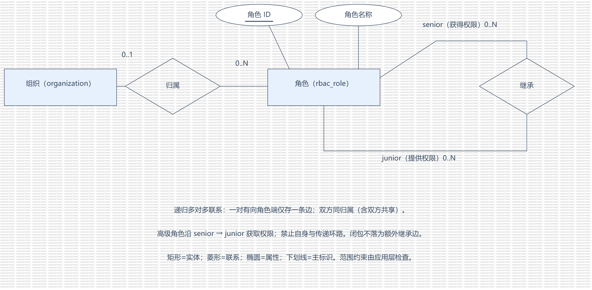

这是**角色继承主题的概念图，不是17张表的全库ER图**。矩形表示组织、角色等实体，椭圆表示属性，下划线属性为标识，菱形表示归属或继承联系；0..1、0..N表达可选和多重性。

一个角色至多归属一个组织，也可为共享角色；一个组织可以拥有多个角色。同一角色实体在继承联系中扮演senior和junior两个端点：**senior获得junior提供的权限**，不是junior自动获得senior权限。一个角色可以继承多个角色，也可以被多个角色继承。

概念图表达联系，应用层再限制同归属或双方共享、管理范围以及不成环。比如“主管→审批员”表示主管获得审批员权限，不能因这条边反向推导审批员拥有主管全部能力。[SVG原图](design/exports/17-shared-角色继承-陈氏ER图.svg)。

### 2.3 继承关系如何落成表

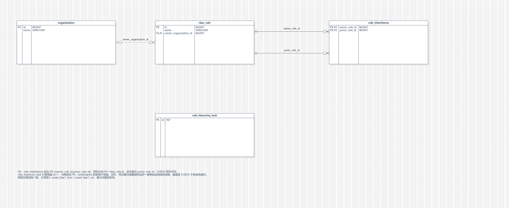

role_inheritance的两个外键都指向rbac_role.id，组合主键阻止重复边，反向索引支持从权限来源寻找受影响角色。只保存直接边，传递关系和多路径闭包在计算时展开并去重，不把所有可达组合重复写入表。

数据库CHECK阻止直接自继承，却不能阻止A→B→C→A。因此继承相关写入先锁role_hierarchy_lock，再读取当前图并校验环路。固定锁行用于跨实例串行化，不能用单机Java锁或不可变Map替代。依据：[V6](../backend-func/src/main/resources/db/migration/V6__create_role_inheritance.sql)。

### 2.4 申请与业务系统

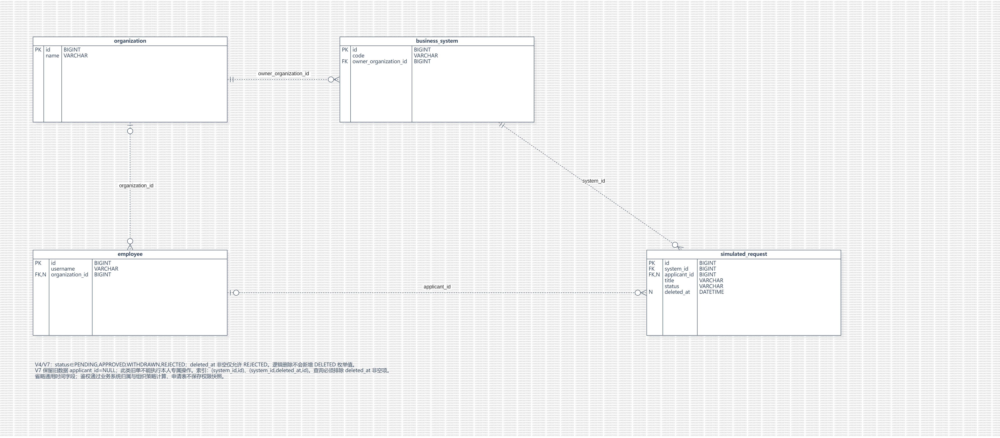

业务系统与申请为一对多；新申请的申请人来自可信当前身份，处理已有申请的system_id来自数据库记录。旧申请允许applicant_id为空，这不赋予任何人“本人修改/撤回/删除”的资格。

status只保存PENDING、APPROVED、WITHDRAWN、REJECTED。逻辑删除通过deleted_at表达，不增加DELETED状态；只有已驳回申请允许被本人删除。列表、计数、详情及加锁查询都应排除已逻辑删除记录。结构依据：[V4](../backend-func/src/main/resources/db/migration/V4__create_simulated_request.sql)、[V7](../backend-func/src/main/resources/db/migration/V7__extend_simulated_request_lifecycle.sql)。

### 2.5 API与所需权限映射

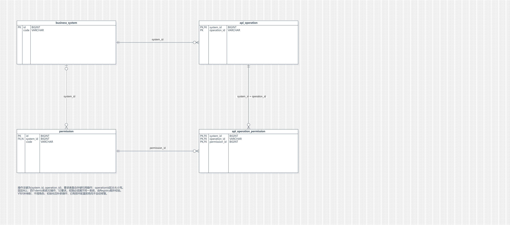

API必须用“业务系统＋operationId”定位，同一operationId在不同系统分别判断。api_operation_permission关联操作组合键和permission.id；外键保证对象存在，是否为同系统权限仍由ApiOperationRegistry校验。operationId区分大小写，多个要求固定ALL。

例如approveRequest要求request:read和request:approve同时有效。首批四个演示系统共32操作、52条权限要求；V9和初始化补齐映射，不恢复已撤销角色或组织策略。预查询不接收具体申请ID，不能替代实际审批中的归属和状态检查。依据：[V9](../backend-func/src/main/resources/db/migration/V9__api_operation_permissions.sql)。

## 3. 角色继承：用两版图对照职责

### 3.1 功能版类图

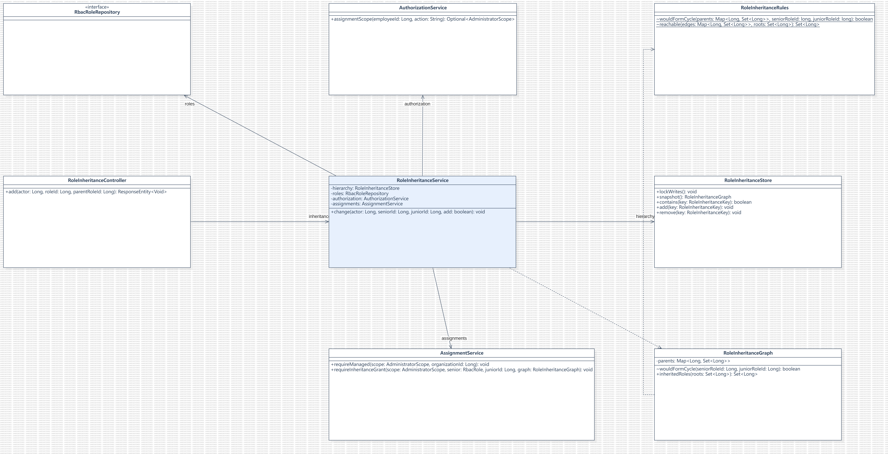

Controller处理HTTP，RoleInheritanceService依次组织资格、锁、数据装载、校验和保存；图快照保存数据，静态规则函数完成可达性和环路判断。规则输入显式、步骤直观，复杂度主要集中在Service编排。

### 3.2 对象版类图

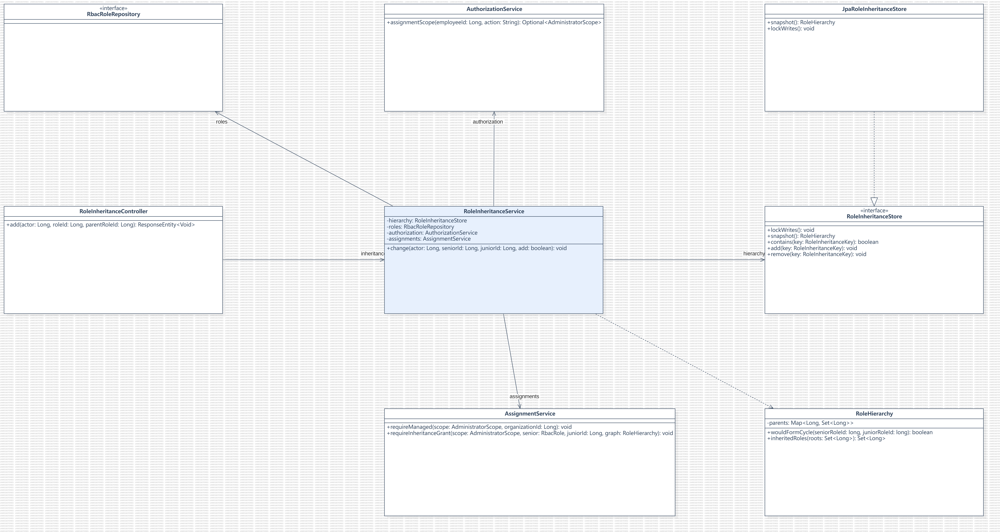

RoleInheritanceService依然控制事务，但通过RoleInheritanceStore取得快照和写入边，JpaRoleInheritanceStore负责JPA协作；RoleHierarchy持有图快照并执行wouldFormCycle、inheritedRoles等行为。AssignmentService检查管理范围与授权影响。

区别在于规则由谁承担，不是“对象版没有Service”。RoleHierarchy不自行提交数据库事务，也不把权限存入登录凭证。实现：[对象版RoleHierarchy](../backend-oo/src/main/java/rolepermission/domain/RoleHierarchy.java)、[功能版源码索引](../backend-func/docs/源码索引.md)、[对象版源码索引](../backend-oo/docs/源码索引.md)。

### 3.3 对象版新增继承时序

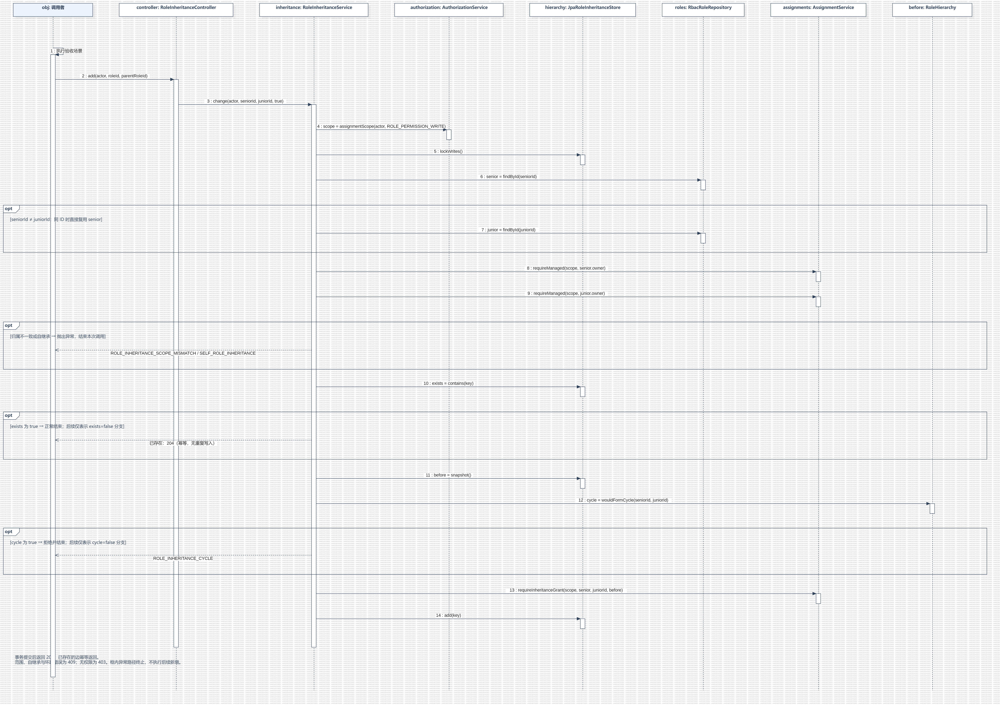

按消息顺序看：可信操作者进入用例 → 管理资格 → 获取图写锁 → 读取角色与当前边 → 双端范围/归属/幂等校验 → 检查是否成环及授权影响 → 写入提交。必须先锁后读，否则两个并发请求可能分别通过旧快照检查，合起来却成环。

合法重复新增不产生重复记录；自继承、跨归属、越权和闭环均拒绝。功能版保持相同接口结果，只将图规则表现为过程式协作，见[图03功能版时序](design/exports/03-func-新增角色继承-时序图.png)。

## 4. 有效权限与组织策略

### 4.1 对象版有效权限类图

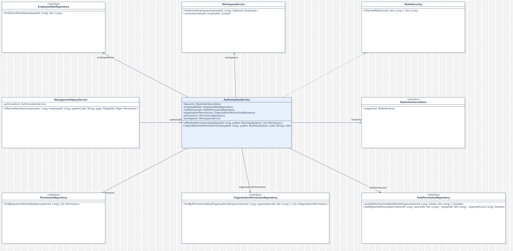

AuthorizationService组织可信员工、系统准入、直接角色、继承图和组织策略的协作；RoleHierarchy计算可达角色。JPA仓储负责读取关系，响应映射不决定授权。功能版对应[图04](design/exports/04-func-有效权限-类图.png)，两版共用规则口径。

### 4.2 有效权限查询时序

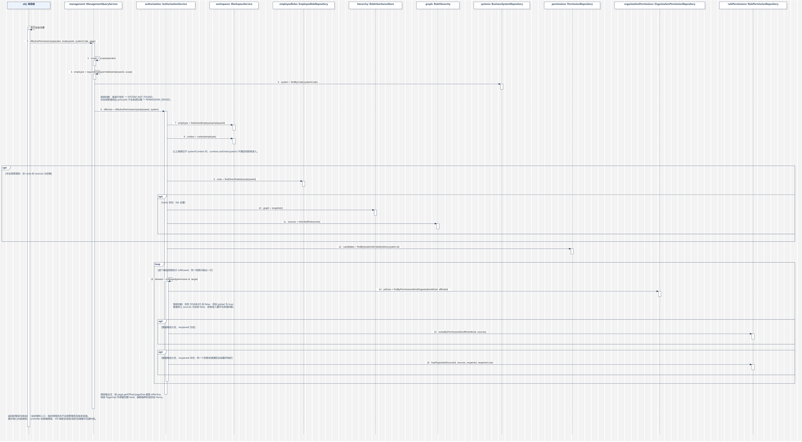

先确定操作者和查询目标的边界，再展开当前直接/继承角色，获取目标系统的候选权限，应用系统准入与组织策略，去重后返回。管理员查询他人与当前用户me是不同入口，不能把管理员范围检查搬成自身查询的前置权限。

“角色涉及这个系统”不等于“该权限目前有效”。DISABLED优先拒绝；存在REOPENED时，同一个直接权限来源角色必须满足所有适用组织的重授，不能把两个不完整来源拼成允许。功能版对应[图05](design/exports/05-func-有效权限-时序图.png)。

### 4.3 组织停用、重开与重授

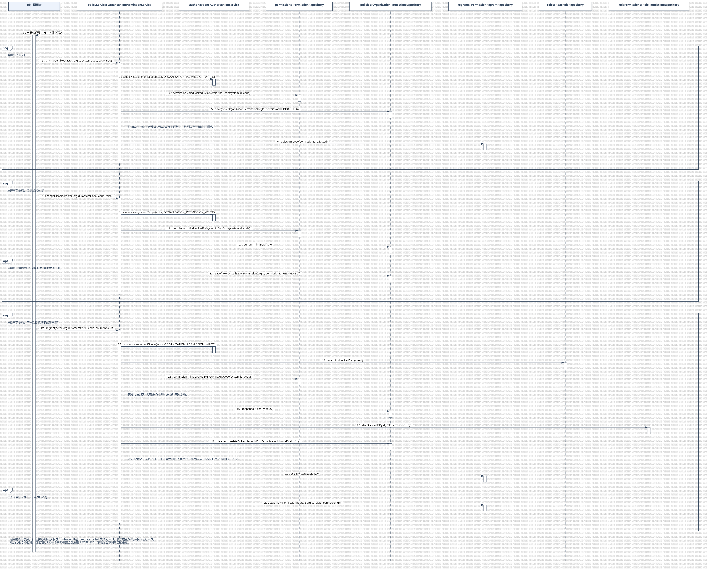

停用保存DISABLED并清理适用旧重授；重开改成REOPENED，不自动恢复旧角色重授；显式重授绑定组织、权限和直接来源角色。role_permission被移除时，其对应重授按外键关系级联清理。组织策略对全局管理员同样有停用约束。对象版对照[图29](design/exports/29-oo-组织停用重开重授-时序图.png)。

实时撤权意味着管理员事务提交后，原登录下一次请求读取最新关系；不是退出所有用户，也不是增加用户版本号。多路径中仍有合法来源时继续允许。完整分支见[图42多路径与删边](design/exports/42-shared-多路径权限与删边-活动图.png)。

## 5. 申请审批：对象行为、事务与状态

### 5.1 对象版申请类图

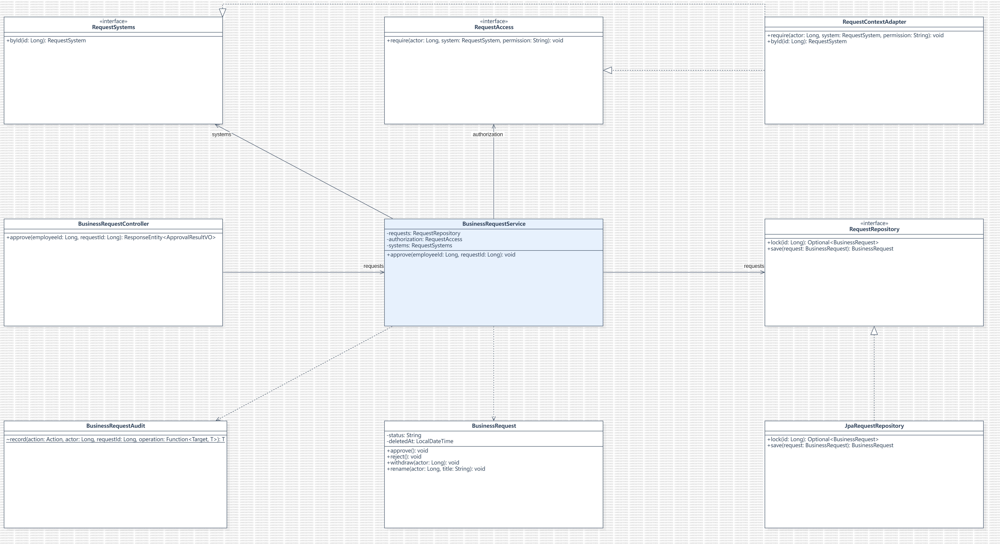

BusinessRequestService组织用例，通过RequestRepository读取/保存、RequestSystems定位系统、RequestAccess执行业务授权；BusinessRequest掌握状态和申请人并执行行为，基础设施适配器负责持久化。CloneFactory用于字段映射，不负责状态合法性或授权。

功能版把状态变更规则放在Service过程内，见[图06](design/exports/06-func-审批申请-类图.png)。两版都要求后端复核，不信任按钮可见性。源码：[对象版申请Service](../backend-oo/src/main/java/simulation/BusinessRequestService.java)、[BusinessRequest](../backend-oo/src/main/java/simulation/domain/BusinessRequest.java)。

### 5.2 审批时序

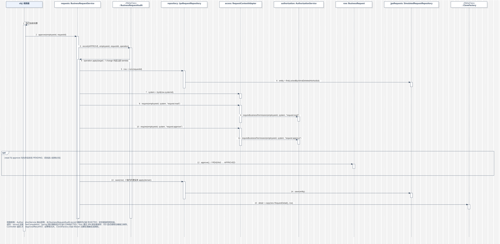

先锁定申请行，再从记录取得系统，检查request:read与request:approve，执行状态行为并保存。对同一PENDING申请竞争审批、撤回或驳回时，仅一个合法状态转换提交，其余按最新状态返回冲突。

申请审计按事务最终结果记录；日志有提交结果不等于只要方法执行到保存就成功。功能版对照[图07](design/exports/07-func-审批申请-时序图.png)，审计时机详见[图38](design/exports/38-shared-事务提交与审计-时序图.png)。

### 5.3 状态图

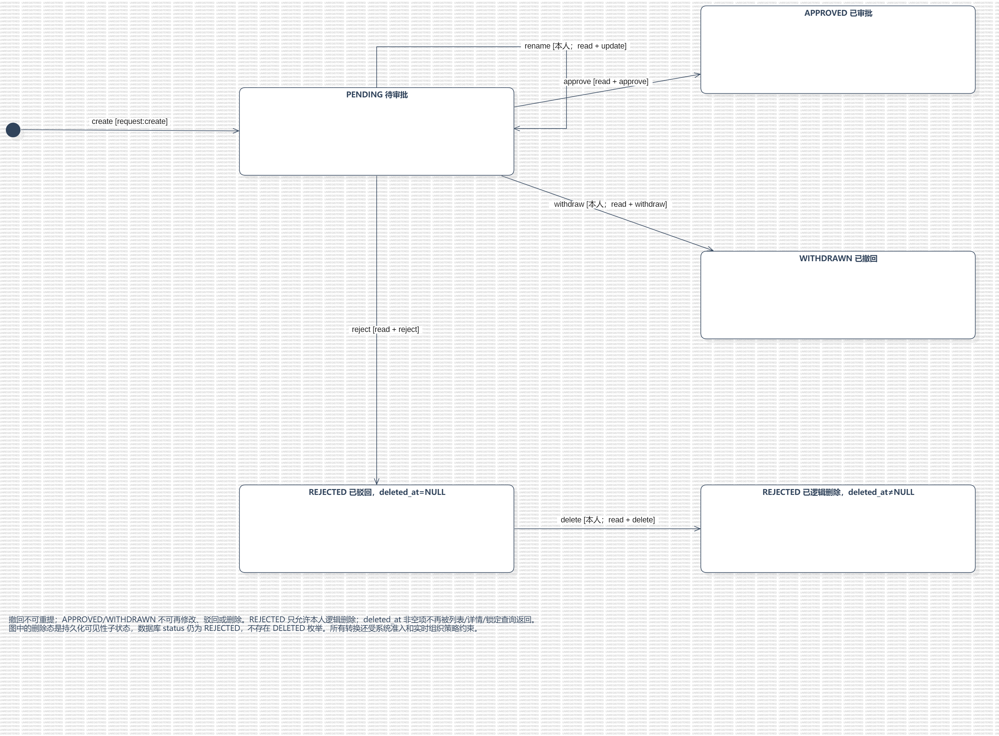

创建后为PENDING，合法修改不改变状态；审批、撤回、驳回分别进入对应终态。WITHDRAWN不能重新提交；REJECTED仅本人可逻辑删除。当前需求允许持有审核权限者审核本人申请，没有额外加入RBAC2职责分离约束。状态合法只是必要条件，实际操作还要具备权限和相应本人资格。

## 6. 统一身份、JWT及部门员工查询

### 6.1 JWT登录生命周期类图

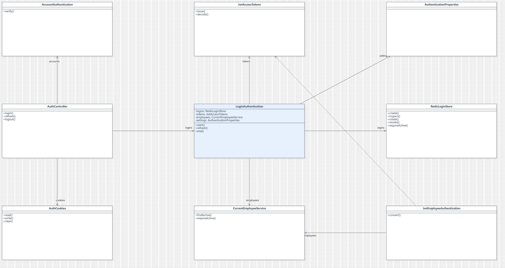

AccountAuthentication校验账号密码，LoginAuthentication组织登录/刷新/退出，JwtAccessTokens签发与解码，RedisLoginStore维护在线sid和刷新摘要，AuthCookies处理Cookie；JwtEmployeeAuthentication将已验证凭证转换为可信员工身份，CurrentEmployeeService检查最新员工资格。

职责拆分使业务Service依赖可信员工，不直接依赖JWT字符串或HttpSession。以前使用Spring Session Redis恢复身份，现在访问JWT只提供身份，权限仍从MySQL实时计算；Redis继续支持即时撤销，不是权限快照缓存。两版密钥、issuer/audience、Cookie和namespace独立。

### 6.2 刷新与重用撤销时序

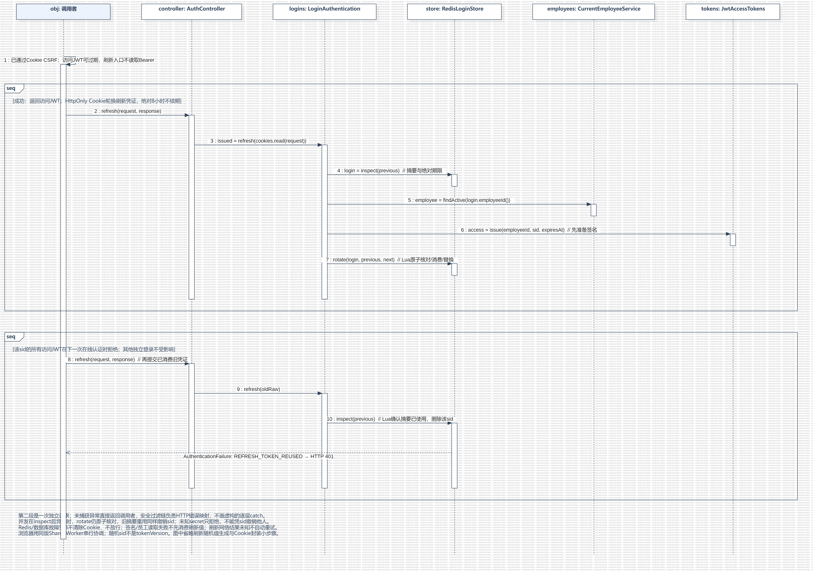

认证入口校验Cookie CSRF并读取HttpOnly刷新凭证；服务端核对sid、摘要、员工状态和绝对期限，以Redis Lua原子消费旧摘要、更新当前摘要，签发新访问JWT并轮换Cookie。确认已消费凭证再次提交时，撤销该次登录，不影响其他独立sid。

访问JWT最长15分钟，登录绝对8小时，刷新不续上限。同版SharedWorker协调标签页，避免并发重复刷新；网络结果不确定时不自动重发已可能消费的凭证。仅凭有效签名不能绕过Redis在线撤销；登录/刷新/退出的Cookie也不能直接认证业务API。源码：[LoginAuthentication](../backend-func/src/main/java/authentication/LoginAuthentication.java)、[RedisLoginStore](../backend-func/src/main/java/authentication/RedisLoginStore.java)。

### 6.3 部门员工查询类图

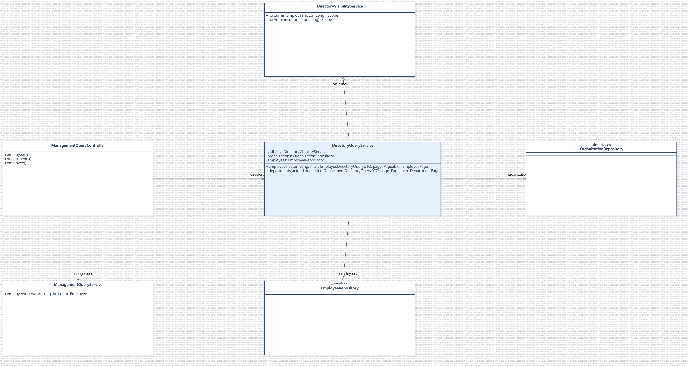

Controller解析tree/directory、parentId、departmentId、q及分页；DirectoryVisibilityService集中计算可见范围，DirectoryQueryService组合范围、筛选和投影，仓储对列表及计数使用一致条件。普通员工只看本组织范围内启用员工的最小字段；管理员仍受所管范围限制，资料电话遮盖。

当前用户身份与自身角色授权的职责连接见[图43](design/exports/43-shared-可信身份与自身授权-类图.png)。指定API预查询复用有效权限，但具体业务还检查申请归属与状态，见[图46](design/exports/46-shared-API预查询与实际授权-活动图.png)。

## 7. 怎样结合代码和测试讲解

| 演示主题 | 建议顺序 | 应观察的结果 |
| --- | --- | --- |
| 继承与防环 | 图17/18 → 图02/10 → 图11 → 前端新增/反向边 | 关系方向正确，合法新增，闭环拒绝，原数据不变 |
| 实时撤权 | 图12/13 → 组织策略 → 原登录请求 | 唯一有效来源撤销后拒绝；有合法替代来源仍允许 |
| 申请审批 | 图19 → 图14/15 → 图25 → 日志 | 权限、状态、本人边界与事务结果一致 |
| JWT | 图48 → 图49 → 页面刷新/退出 | 身份恢复、严格轮换、当前sid撤销、跨版隔离 |
| 员工查询 | 图44 → 部门树/分页/越权 | 查询条件和计数一致，无法越过可见范围 |

本文说明实现和设计，不新增测试通过结论。现有后端、浏览器、JaCoCo和课程集群待验证项目统一见[测试说明](../测试/README.md)。维护时先修改真实实现，再同步StarUML图源/导出/说明，最后复核源码与测试关联，不能只修改图片文字掩盖代码差异。
